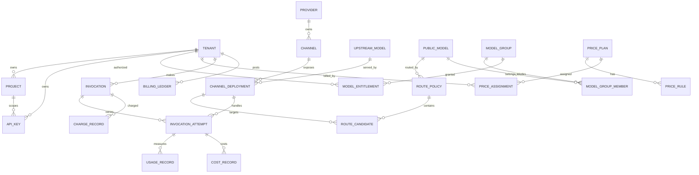

# P-001 核心领域模型 v0.2

## 边界与身份
同一 Data Plane 服务 INTERNAL（Agent Infra）与 EXTERNAL（商业 API）租户。tenant_type 只决定业务策略，不绕过认证、模型授权或用量审计。每次调用必须绑定 tenant_id、project_id（可选）、key_id、request_id。

## ERD

## 实体主键及关键字段
| Entity | Primary key | Critical fields / constraints |
|---|---|---|
| Tenant | tenant_id | tenant_type INTERNAL/EXTERNAL, status, billing_currency, billing_account_id |
| Project | project_id | tenant_id FK, code unique within tenant |
| APIKey | key_id | tenant_id FK, project_id nullable, key_prefix, verifier_hash, scopes, status, expires_at |
| Provider | provider_id | code unique, name, adapter_type |
| Channel | channel_id | provider_id FK, endpoint allowlist, region, credential_ref, status |
| UpstreamModel | upstream_model_id | provider_id FK, native_name, revision, capabilities_json, context_limit |
| ChannelDeployment | deployment_id | channel_id FK, upstream_model_id FK, protocol_family, upstream_api_version, status |
| PublicModel | public_model_id | code unique, display_name, declared_capabilities, status |
| ModelGroup | group_id | code unique, visibility, status |
| ModelGroupMember | group_id + public_model_id | active_from, active_until |
| ModelEntitlement | entitlement_id | tenant_id, group_id, constraints, valid_from/to |
| RoutePolicy | policy_id + version | public_model_id, strategy, constraints, effective_at |
| RouteCandidate | policy_id + version + deployment_id | weight, priority, enabled |
| ChannelHealth | deployment_id + protocol + window | sample_count, ttft_p95, tpot_p95, error_rate, updated_at |
| CostRateCard | cost_card_id + version | deployment_id, currency, effective_from/to |
| CostRateItem | rate_item_id | cost_card_version, metric, unit, price_decimal, conditions |
| PricePlan | plan_id + version | currency, effective_from/to, status |
| PriceRule | price_rule_id | plan_version, metric, unit, price_decimal, conditions |
| PriceAssignment | assignment_id | tenant_id, group_id nullable, plan_id/version, priority, effective interval |
| Invocation | request_id | tenant_id, key_id, public_model_id, protocol_version, route_policy_version, price_snapshot_id, status, timestamps |
| InvocationAttempt | attempt_id | request_id FK, deployment_id, upstream_request_id, upstream_model_id, status, retry_reason, timestamps |
| UsageRecord | usage_id | attempt_id, metric, quantity_decimal, source, confidence, revision, dedupe_key unique |
| CostRecord | cost_id | attempt_id, cost_card_version, amount_decimal, currency |
| ChargeRecord | charge_id | request_id, price_snapshot_id, amount_decimal, currency, status |
| BillingLedger | ledger_entry_id | account_id, request_id, charge_id, amount_decimal, currency, type, idempotency_key unique |
| Invoice | invoice_id | tenant_id, billing_period, currency, status, total |
| Reconciliation | reconciliation_id | provider/channel, period, difference, resolution_status |

## 数据不变量
1. APIKey 原始 SK 只在创建时展示；服务端保存不可逆校验材料或受保护引用。
2. 上游渠道的原生模型和公开模型分离；路由最小单位是 ChannelDeployment。
3. PricePlan、CostRateCard、RoutePolicy 发布后不可原地覆盖历史版本。
4. Invocation 与 Attempt 分离；一个客户端请求可产生多个上游成本。
5. 每次收费绑定价格快照；金额采用 DECIMAL/精确整数，禁止 float。
6. UsageRecord 可追加修正版本，但不能直接抹除原始计量证据。
7. 账务冲正/补记采用新流水，不改写已过账记录。
8. 同一请求计费幂等键唯一；不同币种不直接相加，换汇使用版本化汇率。
9. 路由与权限按租户绑定，数据面不能信任用户传入的 tenant_id。
10. 模型能力映射需显式验证，不允许静默降级 tools、reasoning 或多模态能力。

## 请求生命周期
AUTH → ENTITLEMENT → BUDGET_RESERVATION → MODEL_RESOLUTION → CANDIDATE_FILTER → ROUTE_DECISION → ATTEMPT → STREAM → USAGE_FINALIZE → CHARGE → LEDGER → RECONCILIATION。

## 事务边界
请求及 Attempt 元数据可在 OLTP 中持久化；数据面同步路径避免跨数据库分布式事务。使用 transactional outbox 或等效持久事件保证账务处理可重放；消费者以唯一键去重。账务对账是最终一致，不承诺上游推理 exactly-once。

## 需要 ADR 的开放项
预算严格预留的一致性等级、存储引擎、事件总线、跨模型替代授权、计费币种与汇率来源。
